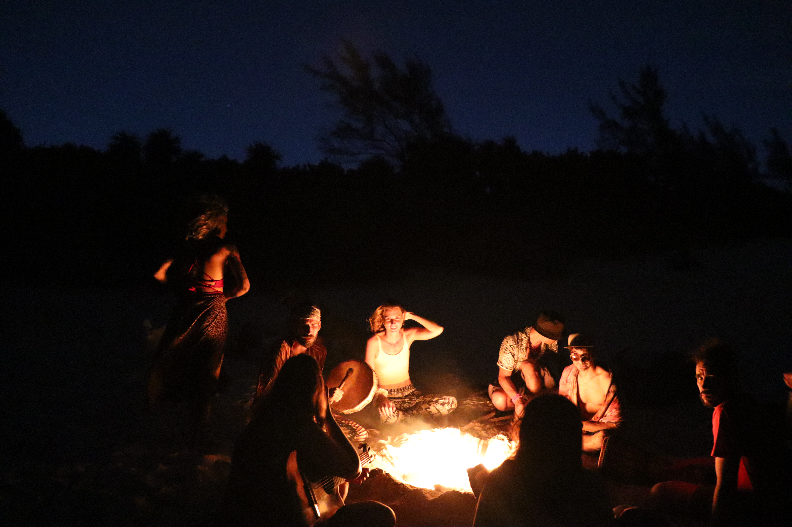
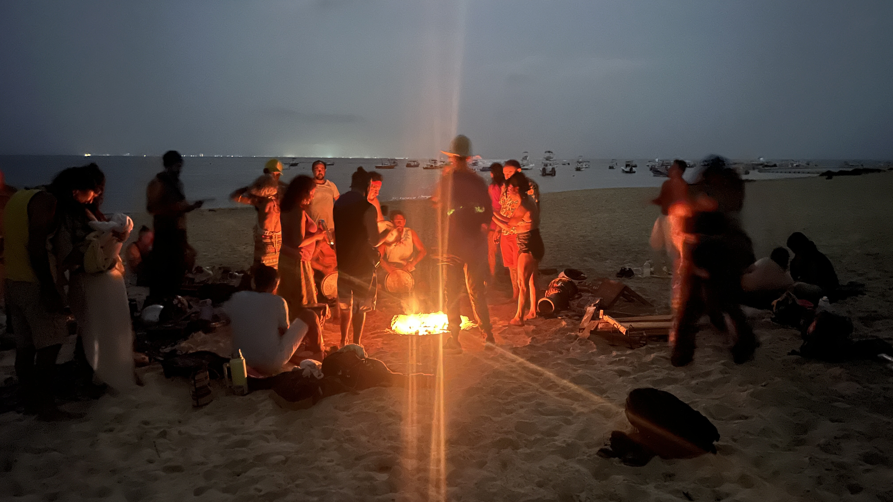
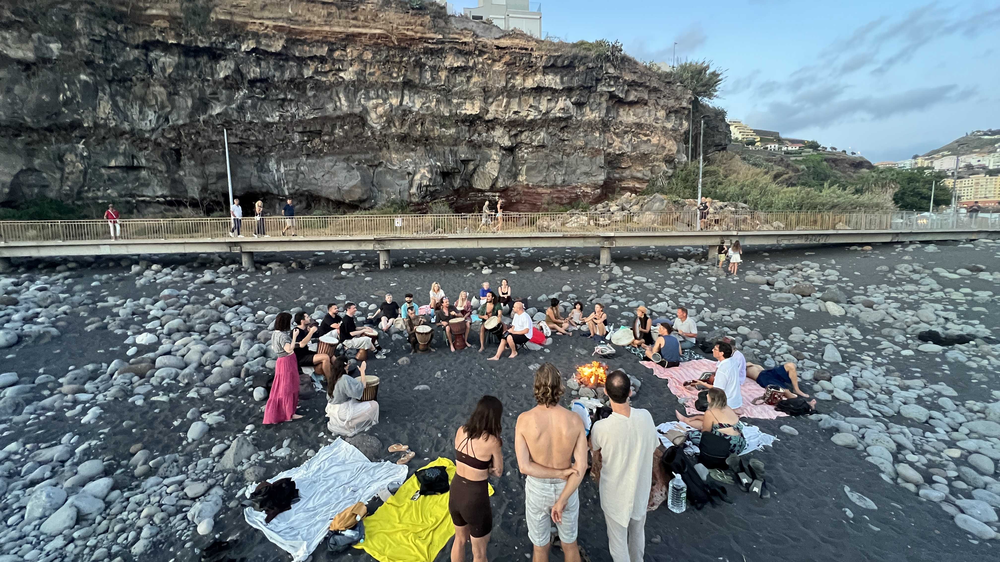

# Lunada Fire Circles around the World

## Lunada ✧ Playa del Carmen, Mexico

The original fire and drumming circle is happening every Sunday and every Full Moon at the local Coco Reef (Playa Cisne - Swane Beach) beach in Playa del Carmen.

If you want to join you can find the Xaman Ha tribe at the only pet friendly beach in Playa del Carmen usually during and after sunset. Bring your furry friend along.

No invitation is required, just show up and vibe with the tribe.

<figure><figcaption></figcaption></figure>

<figure><figcaption></figcaption></figure>

## Drum & Dance ✧ Funchal, Madeira Island

Another fire and drumming circle can be found every Saturday evening if weather permits after around 8pm at Praia Formosa in Funchal, Portugal. This circle has been started by a coupe and friends from the local Madeira tribe in 2026.

No invitation is required, just show up and vibe with the tribe.

<figure><figcaption></figcaption></figure>

