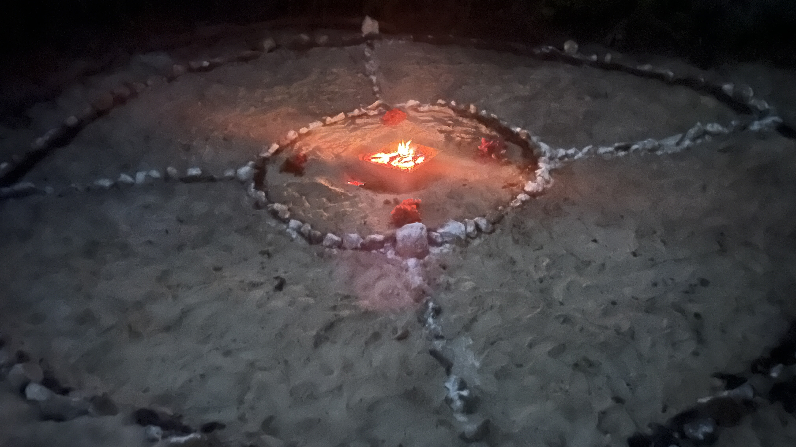

# Medicine Wheels

A medicine wheel is not just a ceremonial structure. It is a sacred technology of the Earth that operates on multiple levels simultaneously.

### ✧ On the Phsyical Level

The stones placed at the cardinal points and in the concentric circles of a medicine wheel act as energetic anchors for the land. They define a field. They tell the earth, "This space is sacred, this space is intentional, this space is guarded."

In an area of ​​rainforest or native vegetation, this is especially powerful because the roots, groundwater, and soil life respond to the coherence of the surrounding field. This is not a metaphor. Soil biology is sensitive to vibrations, sustained intention, and conscious human presence.

### ✧ On the Energetic Level

The medicine wheel is a miniature map of the cosmos. The four cardinal points represent the four elements, the four directions, the four seasons, and the four aspects of the whole human being.

When such a structure physically exists in a place, it creates a field of coherence that literally orders the energy of the space around a center.

An oasis, a green lung, a sacred sanctuary needs this kind of coherence to withstand the pressure of surrounding development.

### ✧ At the Community Level

A visible and active medicine wheel in that space does something no protective sign can.

It communicates to those who arrive that this place has conscious stewardship.

That there are people who care for it, not only physically but also spiritually.

And this conscious stewardship is the oldest and most effective protection that exists for a sacred place.

### ✧ At the specific Mayan Level

In Mayan cosmology, sacred space was always marked and protected with physical structures that aligned the place with cosmic forces.

The Wacah Chan, the Mayan world tree, is precisely this principle. A vertical axis connecting the underworld, the earth, and the sky, and four branches extending in the four directions.

A medicine wheel with stones at the cardinal points and a defined center is the most direct physical expression of Wacah Chan on Earth.

In a place called Xaman Há, sacred northern water, placing this structure is a way to honor and activate the sacred memory that the place already holds.

## The Basic Structre

A traditional medicine wheel has:

✧ A center: The central stone or element that represents the axis of the world, the spirit, that which contains everything, often a fire is lit in the center

✧ An inner circle: it surrounds the central fire or can be prepared to hold an altar&#x20;

✧ Four spokes: Lines of stones extending from the inner circle to the four cardinal points

✧ An outer circle: That contains the entire space and defines the sacred field

✧ Main cardinal stones: A larger or special stone at each of the four points

For a green space next to a cenote, the adaptation would be:

✧ North, Xaman: Red stone or wood, element of air, dawn, new beginnings, the sacred tree if there is a prominent one

✧ East, Likin: Yellow stone or seeds, element of fire, abundance, growth, the direction of the midday sun&#x20;

✧ South, Nohol: White stone or crystal, element of water, direction of the cenote if it can be oriented that way, wisdom and depth

✧ West, Chikin: Black or dark stone, element of earth, sunset, rest, the ancestors Memory

✧ Center: The most special stone in the place; it can be a stone produced by the cenote itself or one brought as an offering from the community. If a fire is placed at the center, the stone can be burried underneath in the ground.

### Sacred Numerology for Creating Your Medicine Wheel

Create your wheel with two concentric circles of stones. The inner circle is marked with the four directions: North, East, South, and West. The outer circle is marked with the four directions and the four half-directions: Northeast, Southeast, Southwest, and Northwest. The fire is at the center of the wheel.

**The arrangement:**

* **Inner circle:** 4 cornerstones at the four directions, with 13 stones between each pair of neighboring cornerstones (4 × 13 = 52).
* **Outer circle:** 8 cornerstones (the four directions and four half-directions), with 13 stones between each pair of neighboring cornerstones (8 × 13 = 104).
* **Directional lines:** 13 stones along each of the four directional lines, placed between the inner and outer circles (4 × 13 = 52). The space inside the inner circle is left open for the fire.
* **Center:** 1 quartz or precious stone of your choice, placed at the fire.

**Total:** 208 wheel stones + 12 cornerstones + 1 center stone = **221 stones**.

<figure><figcaption></figcaption></figure>

<figure><figcaption></figcaption></figure>

**PS: Build wheels that&#x20;**_**follow**_**&#x20;the telluric map** — Not grids imposed on the land, but conversations with it. Your medicine wheel should honor the four directions _and_ the actual water, wind, and magnetic flow of that place.

### Why it is specifically important for space protection

✧ It creates a spiritual and communal argument for protecting the space that goes beyond the legal and political.

✧ It generates a ceremonial gathering point that consciously brings people to the place regularly, and regular conscious presence is the best protection for any natural space.

✧ It activates the memory of the place. The oceans, water bodies and the groundwater holds ancient memories. These aquifer systems have their own intelligence. A medicine wheel on the surface is a way of communicating to that system that there is conscious stewardship above.

✧ It creates the permanent ceremonial heart of an active sacred place, not just a beautiful one. There is a huge difference between a garden and a sacred place. The medicine wheel makes that transition.

✧ It is the physical anchor for all the circles and ceremonies you are already holding there. Every four-element ceremony, every men's and women's circle, every full moon you celebrate in that space feeds the wheel, and the wheel feeds the space. It is a cycle of reciprocity between the community and the land.
