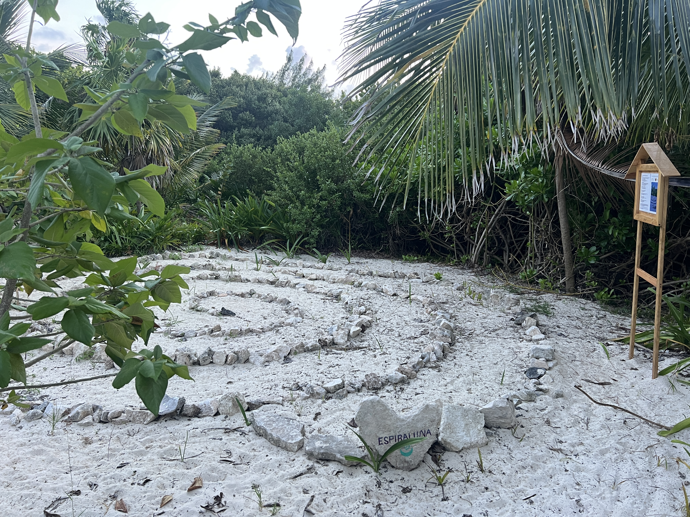
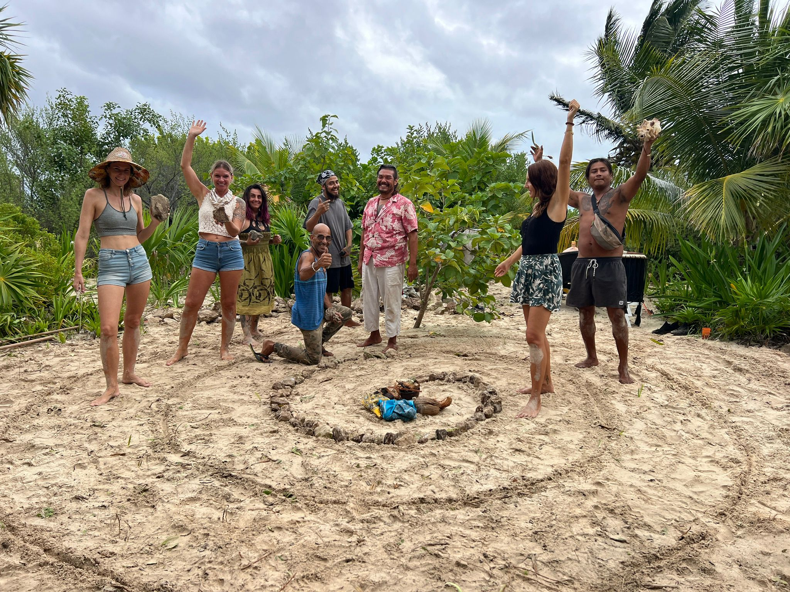
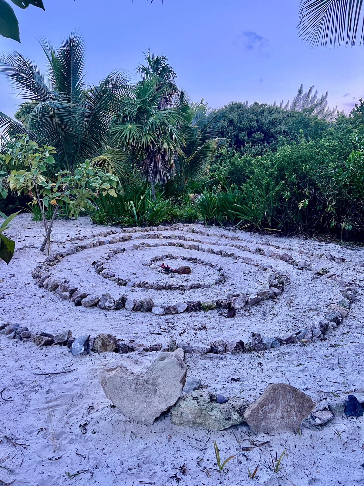
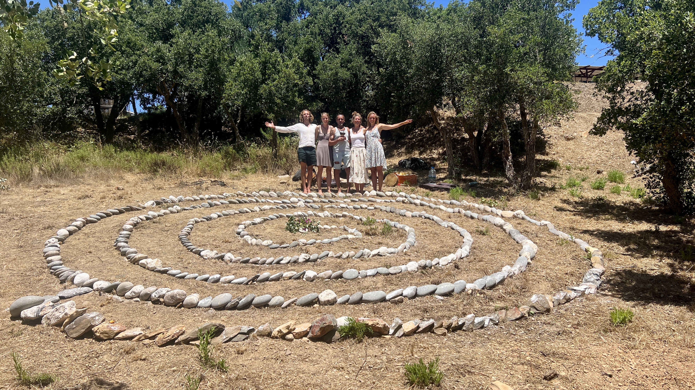
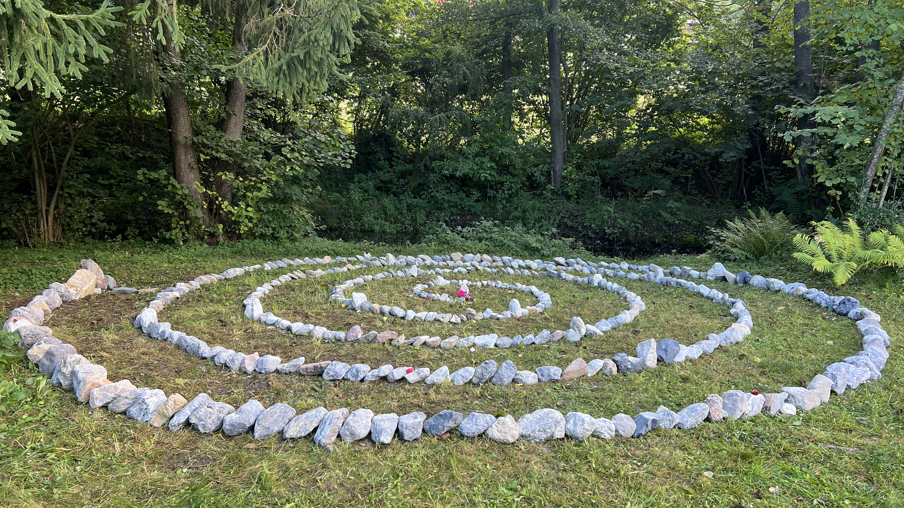
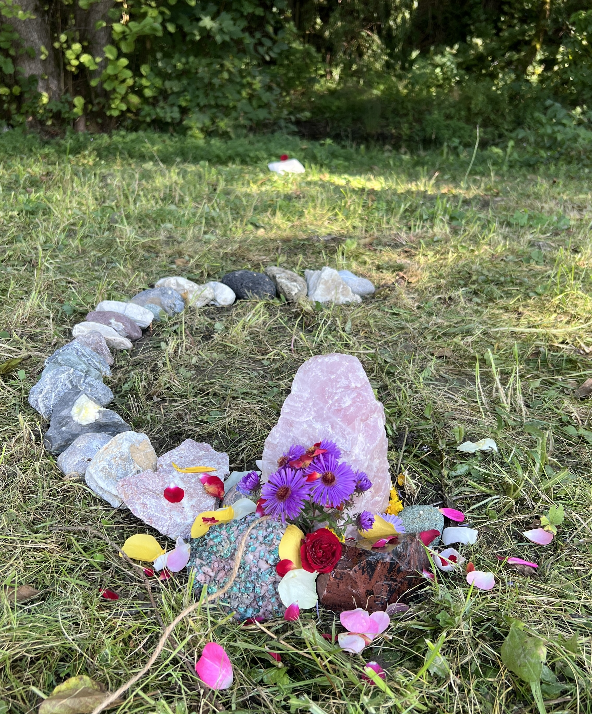
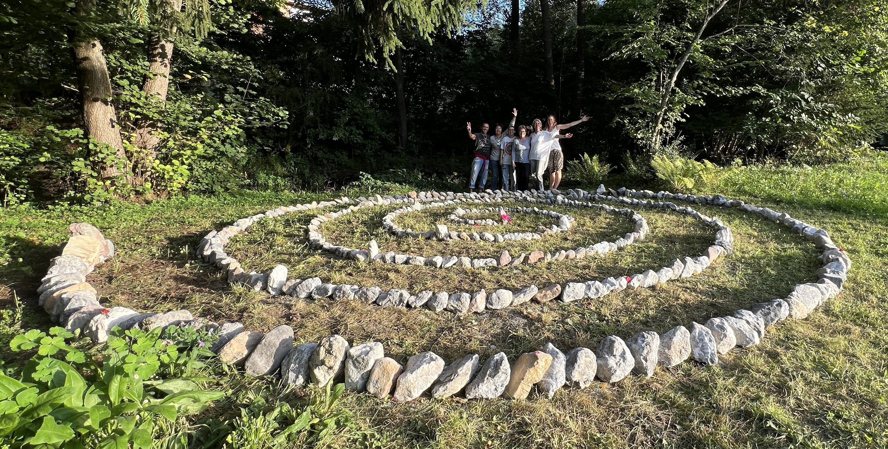

# EN Spirals around the World

## Spiral Connections

Even though the people who built them are different, the locations are distributed, our spirals are deeply connected energetically. They have a grounding force and connect people deeply with the earth and planet.&#x20;

## 1.  Espiral Ma ✦ Madeira Island

The first mother spiral (Ma = Mother, EspirAlma, Soul Spiral) has been built on the Jardim do Pelado in Prazeres, Madeira Island.

<figure><figcaption></figcaption></figure>

<figure><figcaption></figcaption></figure>

## 2. EspiraLuna ✧ Mexico&#x20;

Our second spiral is protecting one of the most precious places on the Carribean cost. It is located within Oasis Maya, supporting the preservation of the last green lung of Playa del Carmen.

<figure><figcaption></figcaption></figure>

<figure><figcaption></figcaption></figure> <figure><figcaption></figcaption></figure>

<figure><figcaption></figcaption></figure>

## 3. Spiral of Essência ✧ Portugal&#x20;

This powerful spiral includes many naturally rounded white quartz stones and therefore reaches an amplified power. It is located in the lovely community of [Essência Nature Retreat](https://essencia.life/) in Aljezur, on the Portuguese mainland.

<figure><figcaption></figcaption></figure>

## 4. Spiral of Light ✧ Austria

In Finkenstein Austria, a new green and colourful spiral emerged, the Lichtspirale in German. It is located next to a natural Bach, a quiet river of water, in a peaceful flower garden. Its center is empowered with many beautiful crystals and a big rose quartz.

<figure><figcaption></figcaption></figure>

<figure><figcaption></figcaption></figure>

<figure><figcaption></figcaption></figure>
